<p align="center">
  
</p>

<p align="center">
  <a href="https://portfolio-adrian-siles-perez.netlify.app/"></a>
  
  
</p>

<p align="center">
  <a href="https://github.com/Asilper86"></a>
</p>

---

## 👨‍💻 Sobre mí

<table>
<tr>
<td width="55%" valign="top">

- 🏭 **QA de aplicaciones en producción** en **Savian Robotics** (desde jun. 2026): pruebo y audito portales web, dashboards Power BI y sensores IoT, y doy soporte técnico.
- 🌐 **Prácticas de desarrollo web** en Savian Robotics (mar.–jun. 2026).
- 🎓 Titulado en **SMR** (2022–2024) y **DAW** (2024–2026), y cursando el **Curso de Especialización en Desarrollo de Aplicaciones en Python** (IES Al-Andalus, Almería).
- 🤖 Desarrollo **automatizaciones con IA** y me apasiona automatizar: auditorías automáticas, informes programados con Azure Functions, Raspberry Pi y herramientas con IA.

</td>
<td width="45%" valign="top">

```python
class Adrian:
    rol      = "Developer & QA"
    stack    = ["Python", "Laravel", "JS/TS"]
    datos    = ["Power BI", "SQL Server"]
    cloud    = ["Azure Functions"]
    hardware = ["Raspberry Pi", "IoT"]
    ia       = ["LLMs", "Agentes"]
    aprendiendo = "Python avanzado"
```

</td>
</tr>
</table>

## 🤖 Automatización e IA

<table>
<tr>
<td align="center" width="25%">⚙️<br/><b>Automatización</b><br/><sub>Scripts y tareas programadas en Python</sub></td>
<td align="center" width="25%">🧠<br/><b>IA aplicada</b><br/><sub>Agentes y LLMs para auditorías y soporte</sub></td>
<td align="center" width="25%">☁️<br/><b>Cloud</b><br/><sub>Informes automáticos con Azure Functions</sub></td>
<td align="center" width="25%">🍓<br/><b>IoT</b><br/><sub>Raspberry Pi, cámaras y sensores</sub></td>
</tr>
</table>

<p align="center">
  
  
  
  
  
</p>

## 🧭 Trayectoria

| Periodo | Rol | Dónde |
|:--|:--|:--|
| `Oct 2026 – hoy` | 🎓 Especialización en Desarrollo de Aplicaciones en Python | IES Al-Andalus |
| `Jun 2026 – hoy` | 🧪 QA / testing de aplicaciones en producción y soporte | Savian Robotics |
| `Mar – Jun 2026` | 💻 Prácticas de desarrollo web | Savian Robotics |
| `2024 – 2026` | 🎓 Grado Superior en Desarrollo de Aplicaciones Web (DAW) | IES Al-Andalus |
| `2022 – 2024` | 🖥️ Grado Medio en Sistemas Microinformáticos y Redes (SMR) | IES Al-Andalus |

## 🛠️ Stack

<p align="center">
  
  <br/>
  
</p>

<p align="center">
  
  
  
  
  
  
</p>

## 🚀 Proyectos destacados

<table>
<tr>
<td width="50%" valign="top">

### 📡 DeviceHub
Gestor de dispositivos IoT: alta, estado y control de equipos y sensores.

 

</td>
<td width="50%" valign="top">

### 🔍 AutoAudit <sub>· privado</sub>
Auditorías automáticas y en paralelo de portales web y dashboards Power BI con IA: detección, clasificación y registro de errores.

 

</td>
</tr>
<tr>
<td width="50%" valign="top">

### 🏎️ [TFG F1 Feed](https://github.com/Asilper86/TFG_F1_FEED)
Proyecto final de DAW: plataforma web sobre Fórmula 1 con feed de noticias y comunidad.

 

</td>
<td width="50%" valign="top">

### 📚 [Biblioteca Digital](https://github.com/Asilper86/-Sistema-de-Gesti-n-de-Biblioteca-Digital-con-Laravel-12-Jetstream)
Gestión de biblioteca con autenticación, roles y préstamos.

 

</td>
</tr>
<tr>
<td width="50%" valign="top">

### 🗓️ TaskFlow Planner <sub>· privado</sub>
Planificador interno para organizar tareas de equipo.


</td>
<td width="50%" valign="top">

### 🚚 [TruckTask](https://github.com/Asilper86/TruckTask) · [V-REPS](https://github.com/Asilper86/V-REPS)
Aplicaciones web en JavaScript y TypeScript.

 

</td>
</tr>
</table>

## 📊 Actividad en GitHub

<p align="center">
  
  
</p>
<p align="center">
  
</p>

---

<p align="center"><sub>⚡ Siempre aprendiendo · ¿Hablamos? Visita mi <a href="https://portfolio-adrian-siles-perez.netlify.app/">portfolio</a></sub></p>
